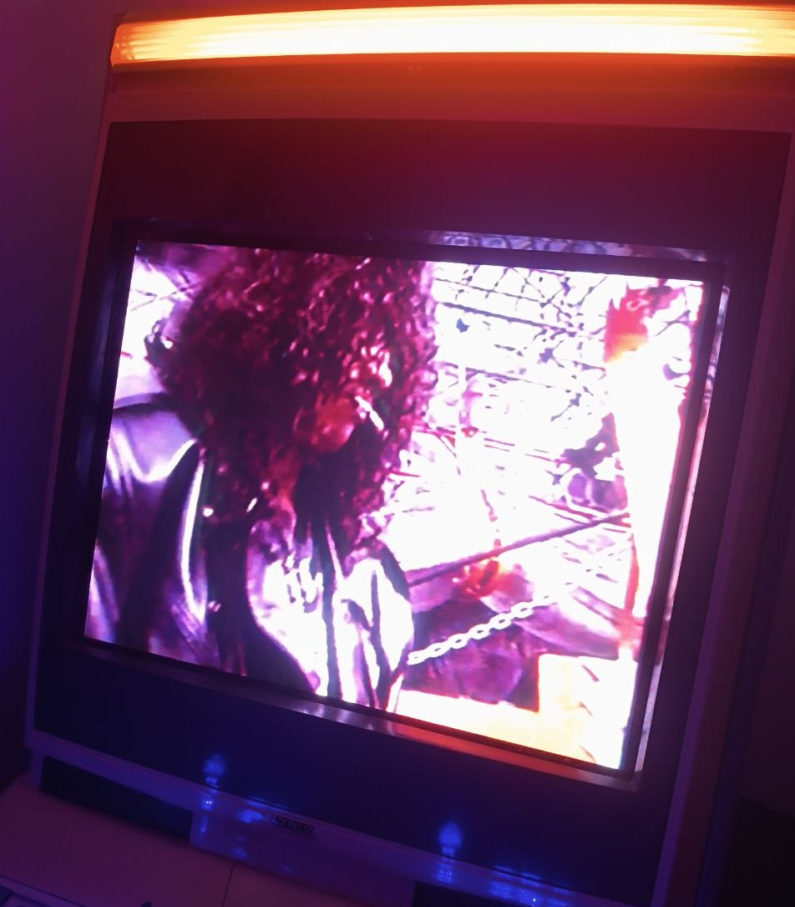

# Sega NAOMI Video Player & Live Network Streamer

PLEASE SUPPORT IF YOU USE IT :(

Some sats are always welcome!


**BTC**: `bc1qfmdwq9ykw4qc9fz4k3e87etjuhh3ruvrhkcsut`


A hardware-accelerated video and 16-bit stereo audio player for the **Sega NAOMI** arcade platform, built with [`libnaomi`](https://github.com/DragonMinded/libnaomi).

Supports **two playback modes**:
1. **Live Network Streaming (`stream_client.py`)** — Stream full-length movies (`.mp4`, `.mkv`, `.avi`, `.webm`) of any duration in real time from your PC over TCP port `10703` into a 64-slot ringbuffer in Net DIMM Cartridge RAM (`0x04010000`), complete with **live arcade joystick seeking (`-10s/+10s`, `-60s/+60s`)**.
2. **Self-Contained ROMFS (`rom://movie.nvp`)** — Bake a video clip directly into `naomi_player.bin` so it plays immediately on boot without a host PC connected.

### Yes, it really works...



---

## Features

- **Full-Resolution 320×240 4-Color Block Truncation Coding (BTC) + Delta Codec**:
  - Every pixel is rendered at true 320×240 resolution (up to 4 refined RGB565 palette entries per 4×4 block with 2-bit per-pixel indexing, zero 2×2 subsampling).
  - Decodes in < 1.5 ms per frame on the 200 MHz Hitachi SH-4 CPU.
- **PowerVR2 (CLX2) Hardware Scaling**:
  - Hardware-upscales `320×240` RGB565 textures to `640×480` at 60Hz with toggleable **Bilinear Filtering** and **4:3 / 16:9 Letterbox** aspect ratio modes.
- **Yamaha AICA 16-Bit Stereo PCM Audio**:
  - 16,000 Hz 16-bit stereo PCM audio streamed into the AICA hardware ringbuffer.
- **Full JVS Arcade Controls**:
  - **P1 Start / Button 1**: Play / Pause
  - **P1 Left / Right**: Seek **-10s / +10s** (works in both Live Network Stream & ROMFS modes!)
  - **P1 Button 5 / Button 6**: Seek **-60s / +60s**
  - **P1 Up / Down**: Volume Up / Down (`0%` – `100%`)
  - **P1 Button 2**: Toggle PowerVR2 **Bilinear** vs **Nearest-Neighbor** texture filter
  - **P1 Button 3**: Toggle **4:3 Fullscreen** vs **16:9 Letterbox**
  - **P1 Button 4 / Service**: Show / Hide On-Screen Display (OSD)

---

## Quick Start

### 1. [Download the binaries (`naomi_player.bin` & `stream_client.py`)](https://github.com/ragnar0K/Naomi-Video-Player/releases/tag/v1.0.0)
Grab `naomi_player.bin` and `stream_client.py` directly from the [Releases page](https://github.com/ragnar0K/Naomi-Video-Player/releases/tag/v1.0.0).

...and if you like to suffer, build `naomi_player.bin` yourself:
```bash
# Build lightweight streaming player ROM (or pass VIDEO=/path/to/clip.mp4 DURATION=30)
make
```
Use netboot to upload `naomi_player.bin` to your DIMM and boot it on your NAOMI cabinet.
I generally use a modified version that does not require a zero Key

### 2. Stream Any Movie Live to the NAOMI
Once `NAOMI VIDEO PLAYER` is running on the cabinet, stream any movie file from your PC:
```bash
python3 stream_client.py <NAOMI_NETDIMM_IP> /path/to/movie.mp4
```
Use your NAOMI joystick (`Left/Right` for `-10s/+10s`, `Button 5/6` for `-60s/+60s`, `Start` for Pause) to control playback directly from the arcade cabinet!
